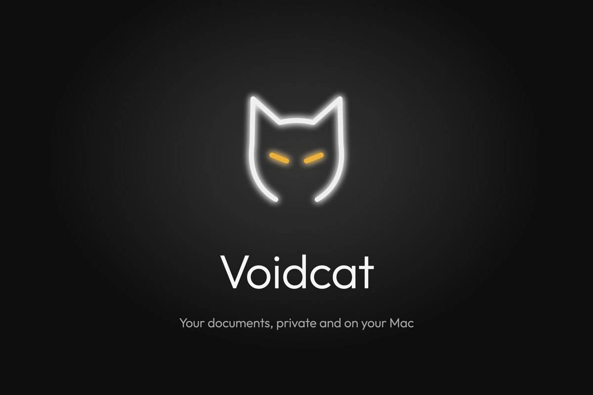
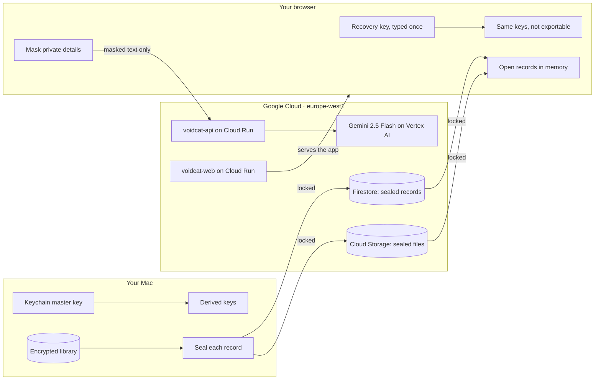

# Voidcat

[](https://github.com/HusDev/voidcat/actions/workflows/ci.yml)
[](LICENSE)



Smart storage for your life. Drop in any document: Voidcat reads it, files it and pulls out the facts. Any AI can use your knowledge, but personal details are masked before anything leaves. Your library lives encrypted on your Mac.

Started at the GitLab Transcend Hackathon (October 2026); now developed here on GitHub. The focus is the local Mac app.

**Website:** https://voidcat.io

## Why

Your important papers (residence permits, leases, payslips, tax forms) are scattered across folders and email. AI assistants could help, but uploading these documents means handing over your most private data. Voidcat keeps the reading on your devices, keeps every copy locked, and only ever shares masked text with an AI.

## What it does

**On your Mac (free, works offline)**

- **Encrypted.** The library database (SQLCipher) and every stored document (AES-256-GCM) are encrypted with a key kept in the macOS Keychain. A recovery key (13 groups of four) is the only other way in.
- **Reads documents locally.** PDFs, photos, scans, spreadsheets and Word files, with Apple Vision OCR and a local model through Ollama (set up from inside the app, no Terminal).
- **Files them** into areas and folders, and **pulls out facts** (dates, ID numbers, amounts, addresses) for you to approve, with the source page highlighted.
- **Calendar and reminders** for expiry dates, appointments, renewals and monthly payments, with Mac notifications and `.ics` export.
- **Ask any AI, safely.** A local model sees your real values and nothing leaves; a cloud model (OpenRouter, zero data retention) only gets text where names, IDs and addresses are placeholders like `[PERSON_1]`. Type @ to ask about one document, folder or area; ask for "my rental papers as a zip" and it gathers them.
- **Catches names the rules miss** with OpenAI's privacy-filter model running on your Mac (optional).
- **Labels** expired, ended, duplicate, unsigned, incomplete and not useful documents.
- **Contacts and Me**: people found in your documents, and a profile of you built from approved facts.
- **MCP server**: Claude Desktop, Cursor or Claude Code can use your library through MCP, with per-app access levels and the same masking.
- **Hide private details** on screen with ⌘⇧H, for screen sharing.

**Voidcat Cloud (paused)**

The code for an end-to-end encrypted browser version is in this repo (`src/cloud/`, `api/`, `deploy/`), but it is not deployed from here for now. What it does:

- **End-to-end encrypted.** Everything is locked on your device before upload; Google Cloud stores only locked bytes. Signing in (email link or Google) says who you are; only your recovery key opens the library.
- **Mac sync.** Connect your Mac in Settings; choose per document whether it's **In the cloud** or **only on this Mac**, with marks on every file.
- **Your library in a browser.** Folders, documents, search and fact review; drop in new files; changes reach your Mac.
- **Read now.** A file added in the browser is read there (OCR included), masked there, and only the masked text goes to Gemini in Belgium to file it. Your Mac re-reads scans with Apple Vision when it syncs.
- **Ask in the browser.** Gemini answers from masked context; the real values are put back in your browser.
- **Your data, your call.** Export everything as a zip, delete your account in one step, plain-words [Privacy Policy](https://app.voidcat.io/#/privacy) and [Terms](https://app.voidcat.io/#/terms). The browser locks after 30 minutes away.

## How the cloud keeps your papers private



1. One random master key, created on your Mac (or in your first browser). The database, file and record keys are derived from it.
2. The Mac seals each document as one record (details, facts, page text) plus its already-encrypted file. Firestore and Cloud Storage only ever see sealed bytes, under rules that let each person reach only their own items, and only with a verified email.
3. A browser derives the same keys from the recovery key and keeps them as non-exportable keys. Records are opened in memory and never stored unlocked.
4. For **Read now** and **Ask**, the text is masked in the browser first. voidcat-api checks the sign-in and the monthly limits (300 reads, 1,000 questions) and logs no text.
5. Changes made in a browser travel back to the Mac as sealed, one-time edits.

Security notes and the latest review: [SECURITY.md](SECURITY.md). Carbon per document, measured with SCI: [docs/SUSTAINABILITY.md](docs/SUSTAINABILITY.md).

## Requirements

- macOS (Apple Silicon recommended)
- [Bun](https://bun.sh) 1.3+ and [Rust](https://rustup.rs)
- [Ollama](https://ollama.com) for the local model (Voidcat walks you through it)
- Optional: an [OpenRouter](https://openrouter.ai) key for cloud models on the Mac (stored in the macOS Keychain)

## Install and run

```bash
bun install
bun run build:mcp     # builds the MCP server the app ships with
bun run tauri dev     # the desktop app
bun run demo          # the desktop app on an empty demo library (invented documents in demo/documents)
```

The browser version needs a Firebase web config in `.env.local` (`VITE_FIREBASE_*`), then `bunx vite --port 1430`.

## Usage

1. Drop documents onto the Library, or use **Choose files**.
2. Approve or correct the facts in **Facts to approve**.
3. Open **Ask** to question your library; you see exactly what will be sent before it goes.
4. In **Connected AIs**, add Voidcat to Claude Desktop or Cursor, or copy the Claude Code command.
5. Press ⌘⇧H anywhere to hide private details on screen.

## Checks

```bash
bun run typecheck
bun run lint
bun run test                       # TypeScript tests (app, cloud, API)
cd src-tauri && cargo test         # Rust tests (run build:mcp first)
bun run privacy                    # the privacy guard
```

## CI

GitHub Actions (`.github/workflows/ci.yml`) runs on every pull request and on `main`:

| Job | What it does |
|---|---|
| `verify` | typecheck, lint, TypeScript tests, build |
| `rust-test` | `cargo test` on Linux with Tauri's packages |
| `privacy-guard` | blocks personal data in what the change adds |
| `mcp-server` | builds the MCP server for Apple silicon and Intel Macs |
| `release` | on `main`, when the version in `package.json` has no tag yet: creates the tag and a GitHub release with that version's `CHANGELOG.md` section and the MCP builds |

To release: bump the version in `package.json`, `src-tauri/tauri.conf.json` and `src-tauri/Cargo.toml` together, add its `CHANGELOG.md` section, and merge.

## Stack

**Mac app:** Tauri 2 (Rust: SQLCipher via rusqlite with FTS5, AES-256-GCM, Apple Vision OCR, macOS Keychain) · React · React Router · Vite · Tailwind CSS v4 · Headless UI · Lucide · Zod · TypeScript · Bun · unpdf · Ollama · Vercel AI SDK + OpenRouter (zero data retention) · Transformers.js (privacy filter) · MCP SDK · Vitest

**Voidcat Cloud (Google Cloud, europe-west1):** Cloud Run (web app on nginx, API on Bun) · Firestore · Cloud Storage · Firebase Authentication · Vertex AI (Gemini 2.5 Flash) · Workload Identity Federation · WebCrypto · Tesseract.js (OCR in the browser)

## Roadmap

- Paid plans with Stripe (€4 a month or €40 a year, 14-day trial); until then the cloud is free to try
- Saved conversations and the "make a zip" tool in the browser
- Firebase App Check and server-side storage limits

See `docs/STATUS.md` for what's built and what's next.

## Support

Open an [issue on GitHub](https://github.com/HusDev/voidcat/issues). Security problems: see [SECURITY.md](SECURITY.md).

## Contributing

Issues and pull requests are welcome. Run the checks above before opening a pull request. Use invented data in tests and examples, never real personal details.

## Author

Hussein Saad Hasan Al Khafaji ([@HusDev](https://github.com/HusDev)).

## License

[MIT](LICENSE). Open-source parts that ship with the app, and their licenses: [THIRD-PARTY-NOTICES.md](THIRD-PARTY-NOTICES.md).

## Project status

Under active development. Screenshots and the demo library use made-up example data.
